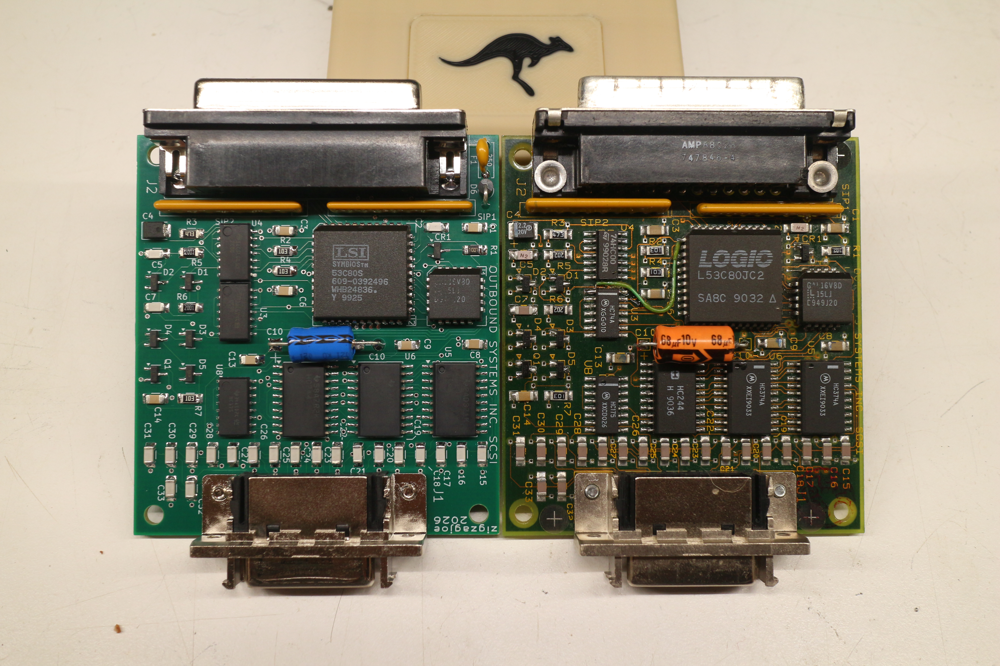

# Outbound Laptop External SCSI Adapter

This is a reverse engineered and recreated schematic/PCB for the external SCSI adapter for the [Outbound Laptop](https://en.wikipedia.org/wiki/Outbound_Systems). An optional Schottky diode and polyfuse were added to power external SCSI emulators such as the ZuluSCSI Slim. 

No warranty, expressed or otherwise; tested to work.

This is licensed under a Creative Commons Attribution-NonCommercial 4.0 International License.

You should have received a copy of the license along with this work. If not, see https://creativecommons.org/licenses/by-nc/4.0/.